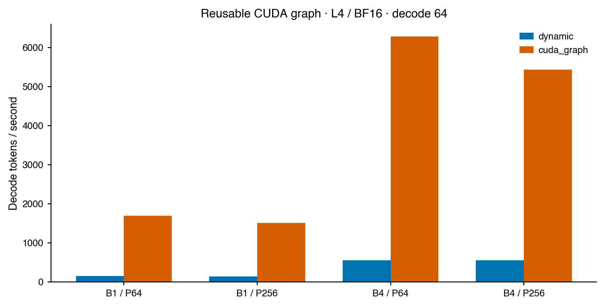

# BranchLab

**An explainable, from-scratch language-model training and inference project.**

BranchLab connects readable implementations with reproducible GPU experiments:
byte-level BPE, a decoder-only Transformer, MHA/GQA, complete-state training
recovery, and measured dynamic/preallocated KV-cache decoding. The portfolio
release includes weights, fixed configurations, raw measurements and checksums.

[中文上手与阅读路线](docs/START_HERE_ZH.md) ·
[Verified results](reports/portfolio/REPORT.md) ·
[Code walkthrough](docs/ARCHITECTURE.md) ·
[Reproduction](docs/PORTFOLIO_REPRODUCIBILITY.md) ·
[CV entries](reports/portfolio/CV_ZH_EN.md) ·
[Colab notebook](notebooks/BranchLab_Portfolio.ipynb)

## Recorded results

| Evidence | Result | Scope |
| --- | ---: | --- |
| Showcase | 17.57M parameters, 39.32M training tokens | TinyStories subset; L4 BF16 |
| Held-out loss | CE 1.2290 / perplexity 3.42 | 65,536 targets; independent evaluation replay |
| CUDA Graph decode | 1,512 tokens/s; 10.50× vs dynamic cache | L4 BF16, batch 1, prompt 256/decode 64; seven repeats; excludes capture/prefill |
| Persistent KV storage | 75% reduction | 8→2 KV heads; equal capacity/dtype; not total GPU memory |
| Correctness | GPU 159 passed / 1 skipped; local 156 passed / 5 skipped | Device skips and one later local evidence-check test explained in report |

The ordinary static-cache path achieved only 1.03× versus uncached decoding in
that short-context workload. Full results include unfavorable seed outcomes,
CUDA graph capture costs and BF16 numerical/argmax differences.



## What you can inspect

| Component | Implementation | What verifies it |
| --- | --- | --- |
| Byte-level BPE | `tokenizer.py` | Unicode round trips, deterministic merges, train-only vocabulary fitting |
| Transformer / GQA | `model.py` | Causal invariance, per-head reference, manual/SDPA output and gradient parity |
| Dynamic / static cache | `model.py` | Multi-token chunk parity, fixed allocation and overflow checks |
| Educational AdamW | `optim.py` | Numerical comparison with PyTorch optimizer |
| BF16 / accumulation / resume | `fit.py` | Equivalent large-batch updates and exact interrupted-run recovery on tested CPU/CUDA |
| Data isolation | `portfolio_data.py` | Pinned source hashes and normalized document exclusion across splits |
| Performance measurements | `systems.py` | Same weights/tokens, warmup, synchronization, rotating order and raw samples |
| CUDA graph replay | `scripts/cuda_graph_decode.py` | Fixed-shape request reset, CPU/CUDA parity and separately reported capture cost |
| Result verification | `scripts/verify_portfolio.py` | Artifact hashes, budgets, finite weights and independently recomputed statistics |

The model is implemented without `nn.Transformer`. Manual attention and AdamW
remain readable reference implementations; optimized GPU runs explicitly use
PyTorch SDPA and fused AdamW. GQA is an existing architecture, and no custom
FlashAttention kernel or new learning algorithm is claimed.

## Try the trained model

```bash
python -m pip install -e '.[dev]'
gh release download v0.2.0 -R liyuqin606-del/branchlab \
  -p branchlab-v0.2.0-inference.tar.gz -p SHA256SUMS
shasum -a 256 branchlab-v0.2.0-inference.tar.gz
# Compare with the matching SHA256SUMS entry, then extract:
mkdir -p artifacts
tar -xzf branchlab-v0.2.0-inference.tar.gz -C artifacts
branchlab generate --model artifacts/portfolio/showcase-gqa \
  --prompt 'Tom found a small red box in the garden.' \
  --tokens 128 --temperature 0.8 --top-k 40 --seed 42
```

For a local interactive interface:

```bash
python -m pip install -e '.[demo]'
python scripts/demo.py --model artifacts/portfolio/showcase-gqa
```

A [screenshot of the working local demo](docs/demo.jpg) includes an uncurated generated story.

The [Colab notebook](notebooks/BranchLab_Portfolio.ipynb) downloads and verifies
the model, generates stories, runs correctness checks, and offers an optional
complete training rerun. The small model is trained on stories; factual accuracy,
instruction following and general chat capabilities are not evaluated.

## Reproduce the study

```bash
branchlab prepare-official --output artifacts/official-data
python scripts/run_portfolio.py --preflight --output artifacts/portfolio-repeat
python scripts/run_portfolio.py --prepared artifacts/official-data \
  --output artifacts/portfolio-repeat --max-seconds 7200
python scripts/verify_portfolio.py --results artifacts/portfolio-repeat \
  --prepared artifacts/official-data
python scripts/report_portfolio.py --results artifacts/portfolio-repeat \
  --prepared artifacts/official-data --output reports/portfolio-repeat
python -m pytest -q
```

A single pinned TinyStories training shard supplies a deterministic 50,000-story
training subset. Development and test each have 512 document-disjoint stories
from official validation; the BPE tokenizer sees only training text. Each final
evaluation uses 65,536 nonrepeated target tokens. Exact normalized overlap with
all validation documents is removed before training selection. Near-duplicate
leakage is not audited; this is a subset study, not a full-data benchmark.

Three prespecified paired seeds compare MHA/GQA at matched token budgets. Width,
depth and data are identical; GQA has different parameter and FLOP counts.
The independently declared showcase uses a larger budget and is excluded from
that comparison. Seven-repeat inference measurements report prefill and decode
separately. Every speedup must retain its hardware, dtype and workload conditions.

## Navigate the repository

```text
src/branchlab/
  model.py             readable Transformer, GQA and both cache implementations
  tokenizer.py         deterministic byte-level BPE
  optim.py             educational AdamW
  portfolio_data.py    pinned official-source subset and leakage checks
  fit.py               BF16, accumulation, evaluation and atomic recovery
  systems.py           three-path inference measurements
  cli.py               preparation, training, generation and benchmarking
configs/portfolio/     frozen MHA/GQA base configurations
scripts/               experiment runner, independent verification and packaging
notebooks/             runnable Colab workflow
reports/portfolio/     actual metrics, raw records, figures and CV copy
docs/                  architecture, reproduction, interview guide and history
tests/                 numerical and end-to-end correctness checks
```

Older `training.py`, `experiments*.py`, `synthesis.py`, `lookahead.py` and
`value_aware.py` support the preserved training-diagnostic research appendix.
New readers can understand and reproduce the portfolio without studying it first.

## Attribution and evidence boundaries

This is an independent, AI-assisted personal engineering project inspired by
[Stanford CS336](https://cs336.stanford.edu/). It is not an official course
submission. Architecture references include [GQA](https://arxiv.org/abs/2305.13245)
and [TinyStories](https://arxiv.org/abs/2305.07759).

The older diagnostic experiments did not establish a cost-adjusted advantage
over strong simple controls. Their NOGO results remain in
[the research history](docs/RESEARCH_HISTORY.md) and original reports. Software
correctness, successful training, performance gains and scientific novelty are
separate conclusions. No RSI success or SOTA claim is made.

Code: [MIT](LICENSE). Data/dependency attribution: [THIRD_PARTY](THIRD_PARTY.md).
Model scope: [model card](docs/PORTFOLIO_MODEL_CARD.md). Use the generated CV entry only
for contributions and implementation details you can personally explain.
