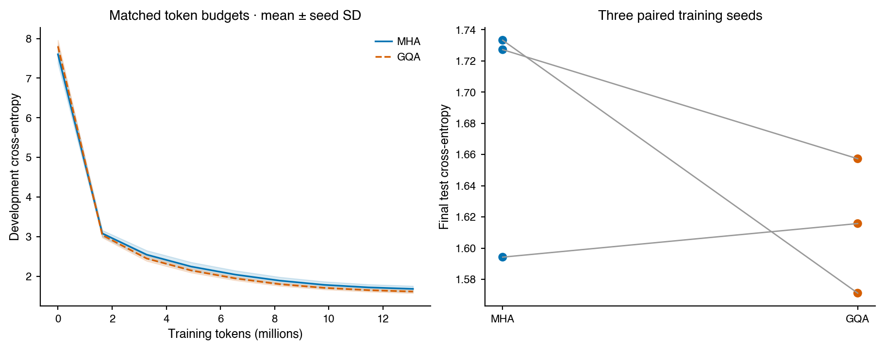
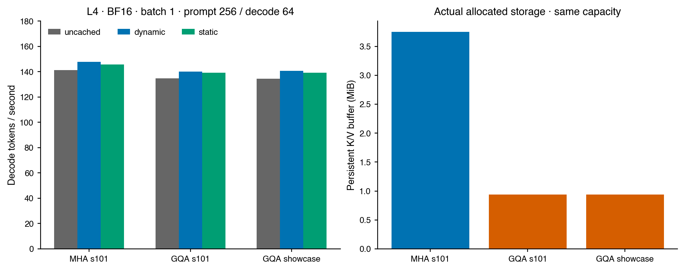

# BranchLab v0.2 — verified language-model engineering

Seven fixed-budget GPU training runs completed in 19.53 minutes, including the original inference grid.
All stored budgets, model weights,
artifact hashes and benchmark summary statistics passed independent record checks.
These checks do not substitute for rerunning training.

## Model and data

The showcase has **17,567,232 parameters**, trained on
**39,321,600 tokens**, with final held-out cross-entropy
**1.2290** and perplexity **3.42**.
Each final evaluation uses 65,536 nonrepeated target tokens.

Training uses a deterministic 50,000-document subset of one pinned official
TinyStories training shard. Development and test each have 512 distinct documents
from official validation, selected before training. All training documents that
exactly match any normalized validation document are excluded. BPE fits only on
10,000 training documents. Near-duplicate leakage is not audited. This is a subset
study, not a full-data or official full-split benchmark.

## MHA/GQA comparison

| Architecture | Parameters | Tokens per run | Test cross-entropy, mean ± seed SD |
| --- | ---: | ---: | ---: |
| MHA | 19,926,528 | 13,107,200 | 1.6849 ± 0.0786 |
| GQA | 17,567,232 | 13,107,200 | 1.6147 ± 0.0431 |

Seeds: 101, 202, 303. Paired GQA-minus-MHA loss differences:
+0.02153, -0.16210, -0.06992; mean **-0.07016**.
Negative values favor GQA. The comparison matches tokens, model width/depth and
seeds; GQA has fewer parameters and different FLOPs. Three seeds are descriptive
and do not establish statistical superiority or general language-model quality.
The independently declared showcase has a larger budget and is excluded from this comparison.

## Same-weight inference paths

The table uses **NVIDIA L4, BF16, batch 1, prompt 256, decode 64, seven repeats**.
Full grid records also include batch 4 and prompt 64. Prefill and decode are timed
separately; these speedups describe decode only. All paths consume identical
forced tokens and use the same checkpoint within each model.

| Model | Path | Decode tokens/s | Speedup vs uncached | K/V buffer MiB |
| --- | --- | ---: | ---: | ---: |
| mha-s101 | uncached | 141.4 | 1.00× | 0.000 |
| mha-s101 | dynamic | 147.9 | 1.05× | 3.750 |
| mha-s101 | static | 145.7 | 1.03× | 3.750 |
| gqa-s101 | uncached | 134.8 | 1.00× | 0.000 |
| gqa-s101 | dynamic | 140.2 | 1.04× | 0.938 |
| gqa-s101 | static | 139.2 | 1.03× | 0.938 |
| showcase-gqa | uncached | 134.6 | 1.00× | 0.000 |
| showcase-gqa | dynamic | 140.8 | 1.05× | 0.938 |
| showcase-gqa | static | 139.2 | 1.03× | 0.938 |

GQA uses **75% less persistent K/V buffer storage** at identical
capacity and dtype. This does not imply the same reduction in total GPU memory.
Static caching's actual speed change versus dynamic concatenation is reported in
the raw grid; preallocation is not assumed to be faster for every workload.

## Reusable CUDA graph extension

This inference-only extension was added after observing the small ordinary-cache
speedups. The training protocol and weights were unchanged. A fixed-shape decoder
reuses a captured graph with device-side position and preallocated K/V buffers.
Measurements use the showcase checkpoint, L4/BF16, 64 forced decode tokens and
seven alternating-order repetitions. Capture/warmup cost is excluded from steady
state and reported separately. Prefill times remain in the raw records.

| Batch | Prompt | Dynamic tokens/s | Graph tokens/s | Speedup | Setup seconds | Mean KL | Argmax disagreement |
| ---: | ---: | ---: | ---: | ---: | ---: | ---: | ---: |
| 1 | 64 | 146.1 | 1689.1 | 11.56× | 0.380 | 0.000154 | 1.56% |
| 1 | 256 | 144.0 | 1512.2 | 10.50× | 0.028 | 0.000110 | 1.56% |
| 4 | 64 | 555.1 | 6280.9 | 11.31× | 0.034 | 0.000128 | 1.56% |
| 4 | 256 | 555.5 | 5436.9 | 9.79× | 0.029 | 0.000150 | 0.00% |

BF16 paths have small numerical differences; argmax disagreements mean identical
free-running text is not guaranteed. Timing uses identical forced tokens to avoid
changing the workload. Fixed weights, dtype, batch and capacity are required;
one decoder serves one serial request at a time. This is not an end-to-end
serving benchmark, custom attention kernel, or universally applicable speedup.

## Correctness and recovery

The published GPU test log records **159 passed / 1 skipped** (MPS unavailable);
the final local log records **156 passed / 5 skipped** (CUDA unavailable). The local
count includes one additional graph-record tampering test added after GPU validation.
All seven final losses were replayed from saved weights with a separate single-window
evaluation loop; see `raw/evaluation_replay.json` for numerical differences.

Tests cover causal invariance, manual/SDPA outputs and gradients, an independent
per-head GQA reference, dynamic/static multi-token cache equivalence, overflow
checks, optimizer equivalence, accumulation, immutable output protection and
complete disk recovery. CPU and CUDA recovery tests require exactly equal final
weights after an interrupted run. Verification logs state the actual tested
software/devices; cross-platform bitwise equality is not promised.

Raw numerical cache errors and distribution KL, CUDA allocation samples,
per-repeat timings, learning curves, full configurations, source hashes and
sampling examples are in `raw/`. See `verification.json` for the verification
scope and `artifact_checksums.json` for report-file hashes.

## Scope and honest claims

This is an AI-assisted personal engineering project. Manual attention and the
educational optimizer are project implementations. Optimized runs use PyTorch
SDPA and fused AdamW; no custom FlashAttention kernel is claimed. GQA is an
existing method. The small story model is not an instruction-tuned assistant.
Historical training-diagnostic experiments returned NOGO and remain documented
in `docs/RESEARCH_HISTORY.md`; no RSI or algorithm-leading claim is made.

Reproduction: `docs/PORTFOLIO_REPRODUCIBILITY.md`.
Code explanation: `docs/ARCHITECTURE.md`.
Interview preparation: `docs/INTERVIEW_GUIDE.md`.
